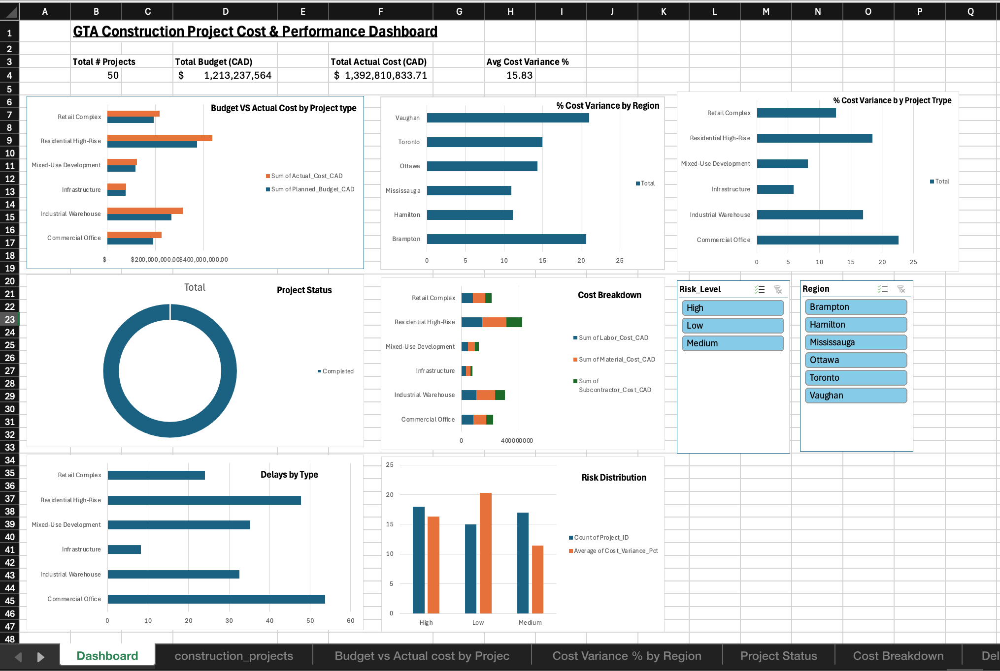
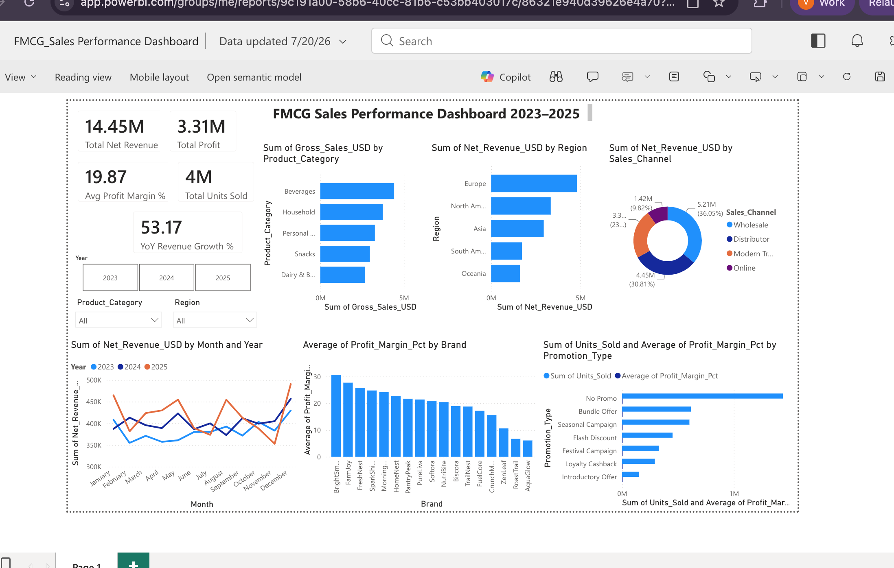
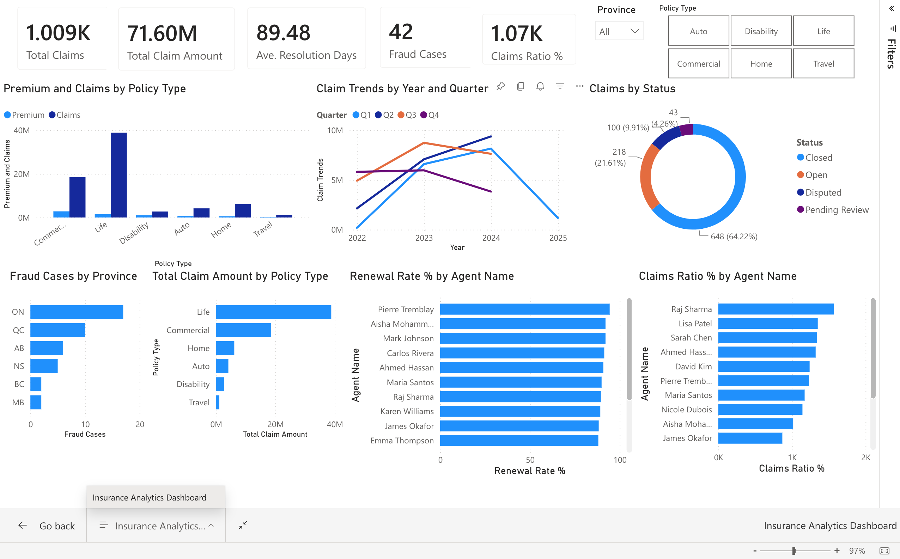

# BI Portfolio — Mark Nwulu

Data analytics and business intelligence portfolio projects.

## Project 1 — GTA Construction Project Cost & Performance Dashboard

**Tools:** Excel (Pivot Tables, Charts, Slicers)  
**Dataset:** Public construction project cost dataset  
**Industry:** Construction

### Business Problem
Identify cost overrun patterns and schedule performance trends across a GTA construction project portfolio to support better estimating and risk management decisions.

### Key Findings
- Residential High-Rise projects showed highest cost overrun at 17% average variance
- Infrastructure projects most on-budget at 3.5% variance
- Low-risk projects overrunning more than High-risk ones 
  — suggesting risk classification methodology needs review
- Brampton and Vaughan had highest regional cost overruns at 20%+

### Dashboard Preview

---

## Project 2 — CPG / FMCG Sales Performance Dashboard

**Tools:** Power BI · DAX  
**Dataset:** FMCG Sales & Profit 2023–2025 (Kaggle, 18,240 rows)  
**Industry:** Consumer Packaged Goods (CPG) / FMCG  

### Business Problem
Analyze 3 years of global FMCG sales data to identify revenue trends, profit margin performance by brand, 
promotional effectiveness, and regional sales distribution — enabling data-driven decisions on marketing spend, product prioritization, and regional expansion.

### Key Findings
- 🏆 Top performing region: Europe
- 💰 Highest margin brand: BrightSmile
- 📊 Most effective promotion type: No Promo
- 📈 YoY revenue growth trend: 53.17%

### Features
- Interactive slicers for Year, Product Category, and Region
- Power BI AI visuals — Key Influencers and Anomaly Detection
- DAX measure for Year-over-Year revenue growth calculation
- 5 KPI cards — Total Revenue, Total Profit, Avg Margin %, Units Sold, YoY Growth %

### Dashboard Preview

**Live Report:** [View on Power BI](https://app.powerbi.com/groups/me/reports/9c191a00-58b6-40cc-81b6-c53bb403017c/86321e940d39626e4a70?bookmarkGuid=89a9c485-6bcf-4148-bc32-2c29a81d3017&bookmarkUsage=1&ctid=6bd75f60-d7d3-48ba-b1ce-d21f2a43dd6a&portalSessionId=5ea017ce-e072-42ef-bdb1-6ec81254b894&fromEntryPoint=export)

## Project 3 — Insurance Analytics Dashboard

**Tools:** Microsoft Fabric · Lakehouse · Delta Tables · PySpark · SQL · Power BI · DAX 
**Dataset:** Generated insurance dataset — 2,000 policies, 1,009 claims, 15 agents across 6 Canadian provinces  
**Industry:** Insurance / Financial Services  

### Architecture
Raw CSV files → Fabric Lakehouse (PySpark ETL) → Delta tables → SQL Analytics Endpoint → Semantic Model with relationships → Power BI Dashboard

### Key Metrics
- Total Claims: 1,009
- Total Claim Amount: $71.60M
- Average Resolution Days: 89.48
- Fraud Cases: 42
- Claims Ratio: 1.07K%

### SQL Written
- GROUP BY and CASE WHEN aggregations
- LEFT JOIN across policies and claims tables
- Subquery filtering above average agents
- Window functions RANK and PARTITION BY province
- YoY claim trend analysis by year and quarter

### Key Findings
- Life insurance generates highest claim exposure
- Ontario accounts for most fraud cases
- Pierre Tremblay has highest renewal rate at 94.4%
- Claims trending upward Q1 2022 through Q3 2024
- 64% of claims closed, 22% still open

### Dashboard Preview

